# Findings

**Question:** Which transcriptional responses to IFN-β are shared across PBMC cell types, and which are cell-type specific? (Kang et al. 2018, 8 donors, control vs IFN-β.)

- Numbers come from the executed notebooks named in each section; the decisions behind them are in [`audit/decisions.md`](audit/decisions.md).
- Full figure legends (method, input, n): [`figures/CAPTIONS.md`](figures/CAPTIONS.md).
- **Conventions:**
  - **Bold** lines are measurements; an indented → line is what they may mean.
  - > ⚠️ **Analysis caveat:** marks a confounder or a limit of the analysis that affects how a result can be read.

---

## Figures at a glance

**[1. EDA, QC + Analysis Sanity Checks](#1-eda-qc--analysis-sanity-checks)**

| Figure | Main takeaway |
|---|---|
| [`fig1_composition`](#fig-1-composition) | Donors differ widely in size (992–5,090 cells) and make-up (`patient_1016` ~30% CD8 T, others < 10%), but each donor's ctrl and stim compositions are alike. |

**[2. Concordance with the published paper](#2-concordance-with-the-published-paper)**

| Figure | Main takeaway |
|---|---|
| [`fig2_umap`](#fig-2-umap) | Stimulated cells separate from control cells within every cell type, most strongly in monocytes (separate ctrl and stim islands); cell types stay distinct in both conditions. |
| [`m0_paper_fig3a`, `m0_paper_fig3d`](#recreated-paper-figures) | Our plots of the authors' t-SNE and cell-type proportions match the paper's Fig 3a and 3d. |
| [`m1b_concordance`](#gene-level-overlap-with-the-paper-v9) | Our DE genes are mostly a subset of the paper's; the paper-only share is largest where we kept fewest donors (megakaryocytes 75%, DCs 46% of the union). |
| [`m2b_v9b_scatter`](#fold-changes-vs-the-paper-v9b) | Our fold changes track the paper's closely (r 0.92–0.99); our shrunken estimates sit nearer the identity line than the unshrunk ones, most visibly in megakaryocytes. |
| [`m2b_f3b_heatmap`](#paper-fig-3b-recreated) | The recreated Fig 3b shows stim-high blocks shared across all groups for the top modules and blocks confined to myeloid groups (CD14+, FCGR3A+ monocytes, DCs); megakaryocyte columns are the noisiest. |

**[3. Validation Checks](#3-validation-checks)**

| Figure | Main takeaway |
|---|---|
| [`m2b_p4_null`](#is-the-ifn-response-really-there) | In every cell type the number of IFN-α genes among up-regulated genes lies far outside 1,000 expression-matched random sets (p = 0.001, the minimum), e.g. CD4 T 78 vs ~5. |
| [`m2b_n1_shuffles`](#are-the-calls-real-and-robust) | Shuffled labels give 0–2 DE genes in every cell type, against 27–2,335 with the real labels. |
| [`m2b_r2_r3`](#are-the-calls-real-and-robust) | Removing outlier cells barely changes the calls (Jaccard ≥ 0.85); the unpaired design agrees least in megakaryocytes (0.50) and DCs (0.67); ≥ 85% of main calls are recovered in both. |
| [`m2b_i6`](#technical-patterns) | Per-donor effect size falls as sample size rises; megakaryocyte samples (fewest cells) have the largest effects (5.3–7.5), most likely a low-count effect. |

**[4. Biological Findings](#4-biological-findings)**

| Figure | Main takeaway |
|---|---|
| [`m2b_p1_isgs`](#canonical-isgs-sanity-check) | *Sanity check: these genes are expected to go up everywhere.* All 10 canonical ISGs are DE in 7 of 8 cell types; megakaryocytes 8 of 10. |
| [`fig3_ifn_signature`](#ifn-signature-scores-fig-3) | The IFN-α score rises in every donor of every cell type, about twice as much in monocytes and DCs as in lymphocytes; IFN-β increased both Hallmark interferon signatures across cell types; the IFN-γ score remained elevated after excluding shared genes. |
| [`fig4_de_heatmap`](#shared-vs-cell-type-specific-genes-fig-4) | The top shared genes (CXCL10, IFIT1/2/3, RSAD2, ISG15, MX1, …) are strongly up in all 8 cell types; the specific genes shown (tested in all 8) change only modestly (\|log2FC\| 1–3.3, own ±3 colour scale; all but FTL starred), and the up-gene Jaccard tree groups the two monocyte types, puts DCs with the lymphocytes, and megakaryocytes apart. |
| [`fig5_programs_heatmap`](#shared-programs-fig-5) | Interferon, RIG-I and inflammatory programs go up and the ribosome goes down in all 8 cell types; specific programs are mostly CD14+ monocytes; by NES profile CD4 T cells stand apart (oxidative phosphorylation and MYC targets up). |

## [Analysis caveats: recap ↓](#analysis-caveats-recap)

---

## 1. EDA, QC + Analysis Sanity Checks

### M0: EDA and QC

*Notebook: `notebooks/00_eda.ipynb`*

**Why**
- To know the quality and size of each donor and each cell type, and how they limit the analysis:
  - **Fewer paired donors** = fewer replicates → each fold change is less certain → lower power to call a gene DE.
  - **Fewer cells per sample** = lower pseudobulk counts → noisier per-sample estimates (the I6 check in [Validation](#technical-patterns) shows exactly this).

**Method**
- Load the counts, attach the authors' labels, compute per-cell QC metrics, apply the basic filters (cells ≥ 200 genes, genes ≥ 3 cells), flag outliers. Nothing is dropped automatically.

**The data**
- **24,673 cells × 15,706 genes** of raw integer counts, all the authors' singlets.
  - After the basic filters: **24,562 cells × 15,701 genes**.
- **8 donors**, each in both conditions; **8 cell types**, using **the authors' labels** from GEO.
  - The h5ad's own `cell_type` (a later re-analysis) agrees on only 91% of cells, so it is not used.
- **84 ribosomal genes.**

> ⚠️ **Analysis caveat:** the data have no `MT-` genes, so % mito can't be computed, and low-quality cells can't be confirmed as damaged.

**The join trap**
- **234 barcode sequences occur in both the control and stimulated runs.**
  - Joining on the raw barcode silently matches only control cells.
  - Joining on (sequence, condition) matches all 24,673 cells, with donor, cluster and t-SNE agreeing 100%.

**Design**
- **7 donor × condition × cell type groups have < 10 cells**, all in dendritic cells and megakaryocytes.
  - Paired donors with ≥ 10 cells in both conditions: 8 for six cell types, **dendritic cells 6, megakaryocytes 4**.

> ⚠️ **Analysis caveat:** condition is confounded with the 10x run (one pool and one run per condition). A run effect can't be separated from IFN-β; this applies to every result.

> ⚠️ **Analysis caveat:** two small donors, `patient_1039` (992 cells) and `patient_107` (1,042), about 0.3× the median donor. Both kept.

**Cell quality**
- **514 cells (2.1%) are > 5 MADs from their donor × condition × cell type median** on counts or genes (379 high, 135 low).
  - All kept; DE is rerun without them as a sensitivity check (R3, [Validation](#are-the-calls-real-and-robust)).

**Biology already visible**
- **% ribosomal reads drops with stimulation**, most in myeloid cells (stim/ctrl median: CD14+ monocytes 0.53, DCs 0.69, FCGR3A+ monocytes 0.72).
  - Total counts and genes detected barely change (≈ 1.0–1.1).
  - → Likely ISG transcription diluting the ribosomal share, so % ribo is kept out of the DE model.
- **Cell-type proportions are stable within donors** (most shifts < 3 percentage points).

> ⚠️ **Analysis caveat:** `patient_107` loses 8.2 points of CD14+ monocytes after stimulation. Kept; it affects proportions, not per-cell-type DE.

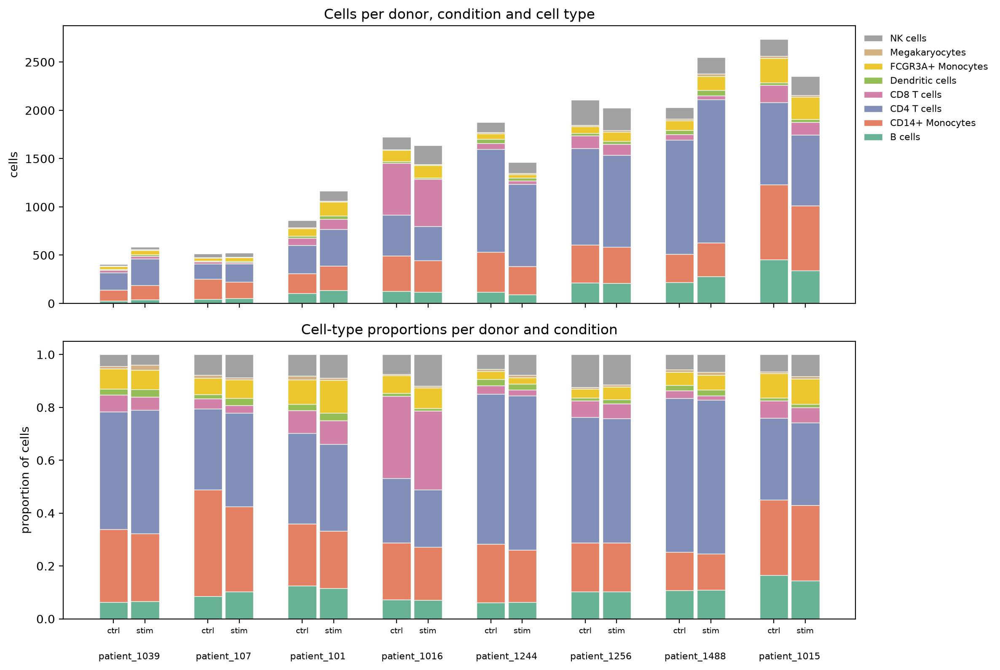

*Fig 1. Cell numbers per donor, condition and cell type.*
- Stacked bars: cell counts (top) and proportions (bottom), ctrl and stim side by side.
- 24,562 cells after filtering; donor order and colours as in Kang 2018 Fig 3d. [Full legend](figures/CAPTIONS.md)

- **Donors differ a lot in size and make-up**, e.g. `patient_1016` is ~30% CD8 T cells, versus under 10% in the other donors.
- **Within a donor, control and stimulated compositions look alike.**

---

### M1a: pseudobulk and variance partitioning

*Notebook: `notebooks/m1a_pseudobulk.ipynb`*

**Why**
- How reliable will the DE genes be? For each gene, how much of its variation comes from **condition** (what we want) rather than **donor**?
  - If donor dominates, a DE call is harder to interpret biologically.

**Method**
- Pseudobulk: raw counts summed per cell type × donor × condition.
- Variance partitioning (`variancePartition`) per gene: the fraction of variance explained by donor, condition, log `n_cells` and log `total_counts`.
- Genes tested: **baseMean > 1**.
  - baseMean = DESeq2's mean of the size-factor-normalised counts across a cell type's samples.
  - Genes at or below 1 are almost never detected in that cell type and are not tested.

**Samples**
- **128 pseudobulk samples** (8 cell types × 8 donors × 2 conditions).
- **116 kept** after the paired 10-cell rule (24,451 of 24,562 cells).
  - Dropped: dendritic cells × {107, 1039}, megakaryocytes × {101, 107, 1016, 1039}.
- Removing the 514 outlier cells changes no sample's kept status.

**What drives each gene's variation** (genes with baseMean > 1: 2,688 in megakaryocytes up to 9,735 in CD4 T cells)
- **The IFN response is unmistakable:** in CD14+ monocytes, ISG15, IFIT1, IFIT3, MX1, OAS1, IFI6 and RSAD2 get 87–96% of their variance from condition (ISG15 in B cells: 98%).
- **Most genes don't respond:** condition's median fraction is 0 in 6 of 8 cell types.
  - Highest in CD14+ monocytes (median 9%), the most responsive cell type.
- **The technical covariates are donor in disguise:**
  - `n_cells` and `total_counts` per sample are near-identical to donor (canonical correlation 0.80–0.99).
  - They are near-identical to each other (0.92–0.997).
  - They are barely related to condition (≤ 0.19; megakaryocytes 0.31).
  - → They absorb donor's share in the variance split rather than adding information.
  - **Decision:** M1b keeps the paper's `~ donor + condition`, with no technical covariate.

**Outlier-looking samples**
- **The most distant samples from their cell type × condition centre (1.7–2.0× the median distance) are 6 of 7 from the small donors 1039 and 107.**
  - → Fewer cells, noisier pseudobulk. Nothing dropped.

---

## 2. Concordance with the published paper

**Why**
- Kang 2018 ran the same analysis (pseudobulk DESeq2 on the same cells). Matching their results checks that our pipeline reads the data the same way.
- We recreated the paper's **Fig 3a** (t-SNE), **Fig 3b** (heatmap of DE genes across cell types) and **Fig 3d** (cell-type proportions), and compared our DE genes and fold changes with their **Supplementary Table 1**.

---

### Reference: the paper's DE results

- Everything in this subsection is **our tally of Kang 2018 Supp Table 1** (`data/kang2018_supp/MOESM4.xlsx`), not our analysis.
- **The paper's method:** DESeq2 `~ donor + condition` on pseudobulk; q < 0.05 and |log2FC| ≥ 1; minimum baseMean 1.00. One sheet per cell type.
- **3,055 unique genes** are DE in at least one cell type.
- IFN-α = Hallmark IFN-α set (97 genes, mapped to the paper's older symbols); canonical = ISG15, IFI6, IFIT1, IFIT2, IFIT3, MX1, OAS1, RSAD2, IRF7, STAT1.

| Cell type (paper's sheet) | DE genes | Up | Down | IFN-α genes up (of 97) | Canonical ISGs up (of 10) | Only DE in this cell type |
|---|---:|---:|---:|---:|---:|---:|
| CD14+ Monocytes (`cd14`) | 2,251 | 1,265 | 986 | 84 | 10 | 1,133 |
| FCGR3A+ Monocytes (`cd16 mono`) | 1,221 | 726 | 495 | 75 | 10 | 261 |
| B cells (`cd19`) | 583 | 426 | 157 | 73 | 10 | 139 |
| Dendritic cells (`dc`) | 581 | 432 | 149 | 71 | 10 | 108 |
| CD4 T cells (`cd4`) | 537 | 418 | 119 | 77 | 10 | 110 |
| NK cells (`nk`) | 351 | 281 | 70 | 68 | 10 | 53 |
| CD8 T cells (`cd8`) | 248 | 212 | 36 | 66 | 10 | 15 |
| Megakaryocytes (`megakaryocyte`) | 107 | 101 | 6 | 45 | 10 | 4 |

**Shared vs specific in the paper**
- How to read the table below:
  - Take the 3,055 genes that are DE in at least one cell type (the union).
  - For each gene, count **how many of the 8 cell types' DE lists it appears in**.
  - 1 = DE in only one cell type (**cell-type specific**); 8 = DE in every cell type (**shared**).

| Number of cell types a gene is DE in | 1 | 2 | 3 | 4 | 5 | 6 | 7 | 8 |
|---|---:|---:|---:|---:|---:|---:|---:|---:|
| Genes | **1,823** | 649 | 227 | 122 | 47 | 38 | 66 | **83** |

- **83 genes are DE in all 8 cell types, all up.** These are genes on **every** cell type's DE list (the intersection), not the union.
  - 41 of them are in the Hallmark IFN-α set (e.g. ISG15, IFIT1/2/3, IFI6, MX1, DDX58, CXCL10, GBP1).
  - → The paper's shared core.
- **Most DE genes are cell-type specific** (DE in exactly one cell type: 1,823 of 3,055).
  - Mostly CD14+ monocytes (1,133 of the 1,823).
  - Down-regulation is also mostly myeloid (986 down in CD14+ monocytes vs 6 in megakaryocytes).
  - What goes down, in our data: see [Shared programs](#shared-programs-fig-5).

> ⚠️ **Analysis caveat:** a gene "specific" to a cell type in the paper may only be underpowered elsewhere (megakaryocytes have 107 DE genes). Our table adds the specific\* flag for this ([section 4](#shared-vs-cell-type-specific-genes-fig-4)).

---

### Fig 2: UMAP

*Notebook: `notebooks/fig1_fig2.ipynb`*

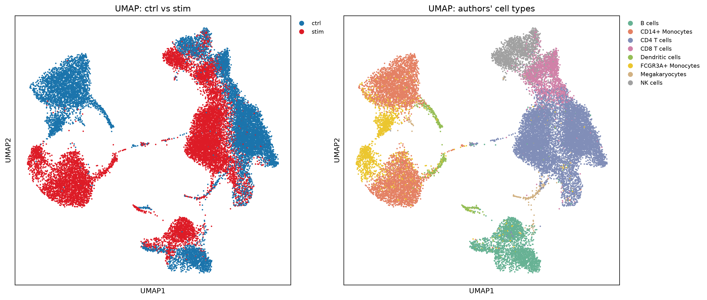

*Fig 2. UMAP of all cells, coloured by condition (left) and cell type (right).*
- Standard scanpy recipe (2,000 HVGs, 50 PCs, k = 15 neighbours, min_dist 0.5); **no integration**.
- 24,562 cells, same coordinates in both panels. [Full legend](figures/CAPTIONS.md)

- **Stimulated cells separate from control cells within every cell type.**
  - Strongest in **monocytes**, which form separate control and stimulated islands.
  - B cells split into two lobes; T and NK cells shift within one connected cluster.
- **Cell types stay distinct in both conditions.**
  - → The authors' labels hold up after stimulation.

---

### Recreated paper figures

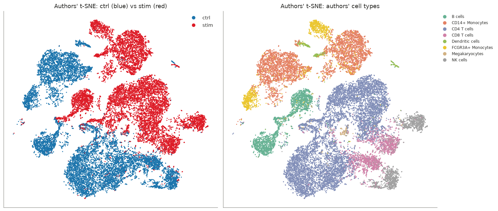

*Recreated Kang 2018 Fig 3a. The authors' t-SNE, coloured by condition (left) and the authors' cell types (right).*
- Authors' coordinates from GEO, not recomputed; 24,562 cells. [Full legend](figures/CAPTIONS.md)

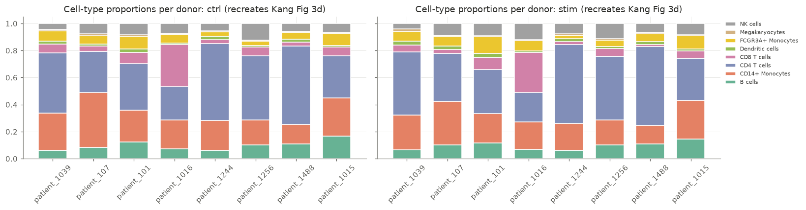

*Recreated Kang 2018 Fig 3d. Cell-type proportions per donor, ctrl (left) and stim (right).*
- 8 donors in the paper's order; 24,562 cells. [Full legend](figures/CAPTIONS.md)

- **Both match the paper's Fig 3a and 3d.**
  - → The join and the labels are read as the authors intended.

---

### M1b: DE counts vs the paper

*Notebook: `notebooks/m1b_de.ipynb`*

**Method**
- Paired pseudobulk DESeq2 (`~ donor + condition`) per cell type; DE = q < 0.05 and |log2FC| ≥ 1.

| Cell type | Paired donors | Ours up / down | Paper up / down |
|---|---:|---:|---:|
| CD14+ Monocytes | 8 | 1,219 / 1,116 | 1,265 / 986 |
| FCGR3A+ Monocytes | 8 | 600 / 319 | 726 / 495 |
| CD4 T cells | 8 | 378 / 105 | 418 / 119 |
| B cells | 8 | 344 / 89 | 426 / 157 |
| NK cells | 8 | 217 / 40 | 281 / 70 |
| CD8 T cells | 8 | 159 / 10 | 212 / 36 |
| Dendritic cells | **6** | 272 / 52 | 432 / 149 |
| Megakaryocytes | **4** | 23 / 4 | 101 / 6 |

- **Same shape as the paper:**
  - CD14+ monocytes respond most (2,335 DE genes, half of them down), then FCGR3A+ monocytes.
  - Lymphocytes respond mostly upward; megakaryocytes least.
- **Fewer DE genes than the paper everywhere**, most in dendritic cells and megakaryocytes.
  - → Those are the cell types where the 10-cell paired rule left 6 and 4 donors (the paper likely used all 8), so lower power is the likely reason.

---

### Gene-level overlap with the paper (V9)

**Method**
- Pass mark (V9): ✓ if we recover > 70% of the paper's DE genes.
- Overlap is by gene, either direction.
- 10 paper symbols mapped to our names: 5 Excel date-mangled (e.g. SEPT9), 5 `.1` make-unique names (e.g. PSMA2.1).

| Cell type | In both | Ours only | Paper only | % paper recovered | % ours in paper | V9 |
|---|---:|---:|---:|---:|---:|:-:|
| CD14+ Monocytes | 1,909 | 426 | 342 | 84.8 | 81.8 | ✓ |
| CD4 T cells | 429 | 54 | 108 | 79.9 | 88.8 | ✓ |
| B cells | 405 | 28 | 178 | 69.5 | 93.5 | ✗ |
| FCGR3A+ Monocytes | 821 | 98 | 400 | 67.2 | 89.3 | ✗ |
| NK cells | 234 | 23 | 117 | 66.7 | 91.1 | ✗ |
| CD8 T cells | 149 | 20 | 99 | 60.1 | 88.2 | ✗ |
| Dendritic cells | 307 | 17 | 274 | 52.8 | 94.8 | ✗ |
| Megakaryocytes | 26 | 1 | 81 | 24.3 | 96.3 | ✗ |

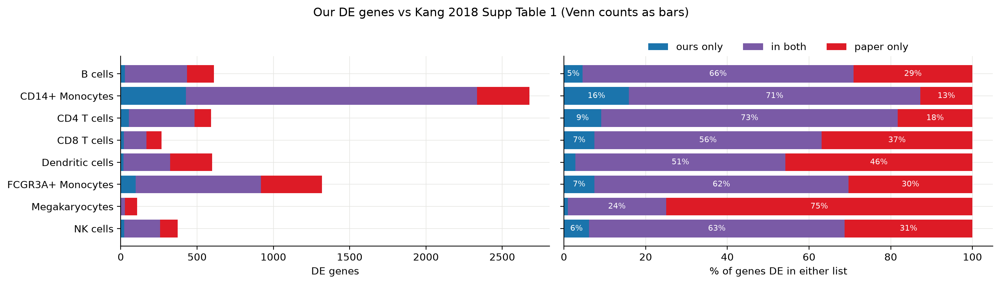

*Our DE genes vs Kang 2018 Supp Table 1.*
- Per cell type: genes DE in ours only (blue), both (purple), paper only (red); counts (left) and % of the union (right). [Full legend](figures/CAPTIONS.md)

**Results**
- **V9 passes in 2 of 8 cell types** (CD14+ monocytes 85%, CD4 T 80%); fails in 6 (24–70%).
- **Our calls are nearly a subset of the paper's:** 82–96% of ours are in it.
- **No shared gene has the opposite sign** (4,280 gene × cell type pairs DE in both, 0 in the opposite direction).
- **The gap is genes only the paper calls**, worst in megakaryocytes (75% of the union) and dendritic cells (46%).
  - The paper also used |log2FC| ≥ 1, so the threshold doesn't explain it.

**Two likely causes, tested as diagnostics** (our method unchanged)
1. **Dropped donors (rule A1):** dendritic cells and megakaryocytes keep 6 and 4 donors here; the paper probably used all 8.
   - Fewer donors means less power, which fits the two worst cell types (53% and 24% recovered).
2. **qvalue scope (O3):** we correct each cell type separately.
   - If the paper corrected all cell types together, CD14+ monocytes' strong signal would lower the bar for the weaker cell types.
   - That would recover "paper only" genes in exactly the cell types where we miss them, including those that kept all 8 donors (B, FCGR3A+, NK, CD8: 60–70%).

**Diagnostic results** (% of the paper's DE genes recovered)

| Cell type | Main run | Pooled qvalue (all 8 cell types together) | All 8 donors (A1 off) |
|---|---:|---:|---:|
| CD14+ Monocytes | 84.8 | 72.9 | – |
| CD4 T cells | 79.9 | 80.8 | – |
| NK cells | 66.7 | **75.2** | – |
| B cells | 69.5 | **72.9** | – |
| CD8 T cells | 60.1 | 68.5 | – |
| FCGR3A+ Monocytes | 67.2 | 61.4 | – |
| Dendritic cells | 52.8 | 60.1 | **70.7** |
| Megakaryocytes | 24.3 | 53.3 | 49.5 |

- **Each explains part of the gap, neither all of it.**
  - Pooling helps the weaker cell types (NK and B pass) but lowers both monocyte types, so the paper probably didn't simply pool either.
  - Keeping all donors lifts DCs over 70% and doubles megakaryocytes.
  - → The rest is likely due to differences we can't see (e.g. the paper's DESeq2 version and settings).
- **Our calls are the more conservative set:** 82–96% of them are in the paper, with no sign flips.
- **Decision:** the V9 result is accepted as reported; the method stays as decided.

---

### Fold changes vs the paper (V9b)

*Notebook: `notebooks/m2_validation.ipynb`*

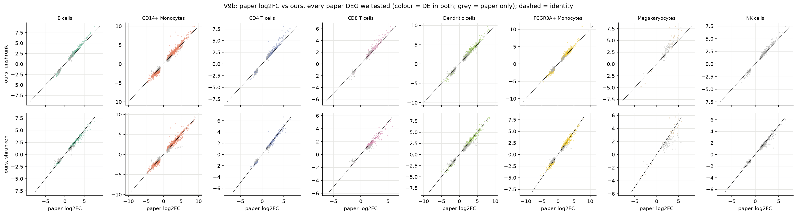

*log2 fold changes reported by Kang 2018 (x) vs ours (y).*
- Every paper DE gene tested in our analysis (105–2,135 per cell type); unshrunk (top) and DESeq2-shrunken (bottom); dashed line = identity. [Full legend](figures/CAPTIONS.md)

- **Fold changes agree closely:** Pearson 0.98–0.99 (megakaryocytes 0.92).
- **The paper's fold changes look shrunken:** the median |paper − ours| is smaller for our shrunken values in most cell types.
  - Our calls stay on unshrunk values (decision).

---

### Paper Fig 3b recreated

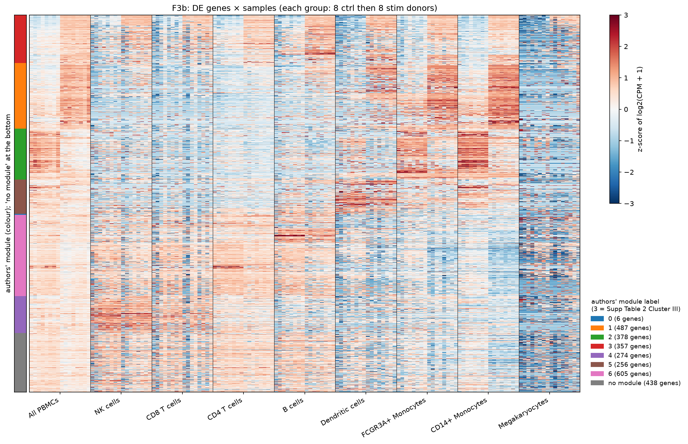

*Recreated Kang 2018 Fig 3b.*
- 2,801 DE genes × 144 pseudobulk samples (all PBMCs + 8 cell types, ctrl then stim); log2(CPM + 1), z-scored per gene; rows ordered by the authors' 7 gene modules. [Full legend](figures/CAPTIONS.md)

- **Stim-high blocks shared across all groups** for the top modules, and **blocks confined to myeloid groups** (CD14+, FCGR3A+ monocytes, DCs); megakaryocyte columns are the noisiest.
- **Our 7 k-means modules vs the authors' 7: adjusted Rand index 0.33** (moderate; method inferred).
  - The authors' Cluster III ("up in all leukocytes") splits across two of ours.
  - The one holding most of it is enriched for **RIG-I-like receptor signalling** (q 3e-5) and **cytosolic DNA sensing**, the antiviral terms the paper reported.
  - KEGG legacy lacks the paper's top terms (Measles, Influenza A).

---

## 3. Validation Checks

*Notebook: `notebooks/m2_validation.ipynb`; full report: [`audit/validation_report.md`](audit/validation_report.md)*

**Why**
- Each check tests the DE calls against a control or a pass criterion agreed in [`audit/validation_plan.md`](audit/validation_plan.md) **before** any results existed.
- Numbers and plots; only V9 has a pass mark (see [Concordance](#gene-level-overlap-with-the-paper-v9)).

---

### Is the IFN response really there?

**Yes, by every measure.**
- **P1:** all 10 canonical ISGs are up in 7 cell types; megakaryocytes 8/10. None goes down anywhere (plot in [section 4](#canonical-isgs-sanity-check)).
- **P2:** Hallmark IFN-α genes are 44–174× over-represented among up-regulated genes (BH q ≤ 1.8e-17 in every cell type).
- **P3:** they are essentially absent among down-regulated genes (0 in 6 cell types).
- **P4 (expression-matched null):** the IFN-α count beats all 1,000 draws of expression-matched random genes in every cell type (p = 0.001, the minimum), e.g. CD4 T 78 observed vs 4.6 expected.
  - → The enrichment isn't just "highly expressed genes".
- **I5:** 0 ribosomal and 0 mitochondrial genes among the top 50 shared genes.
  - Top 10: CXCL10, IFIT1, CCL8, IFIT3, RSAD2, IFIT2, CMPK2, ISG15, TNFSF10, MX1.

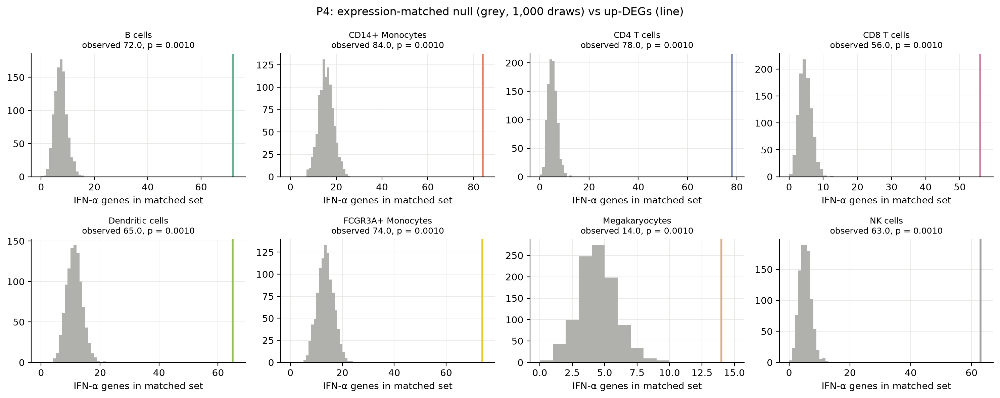

*Hallmark IFN-α genes among up-regulated genes vs an expression-matched null (P4).*
- Grey: 1,000 random gene sets matched on expression and detection (seed 0); line: observed count. [Full legend](figures/CAPTIONS.md)

---

### Are the calls real and robust?

**Yes.**
- **N1 (label shuffles):** 0–2 DE genes vs 27–2,335 with the real labels.
- **R1 (leave one donor out):** 100% of 4,947 DE calls keep their sign when any one donor is left out.
- **R2 (unpaired design):** recovers 89–99% of calls.
  - Jaccard 0.50 megakaryocytes, 0.67 DCs, 0.79–0.93 otherwise.
- **R3 (outlier cells removed):** recovers 85–99.7% (Jaccard 0.85–0.99).
- No sign flips in R2 or R3.

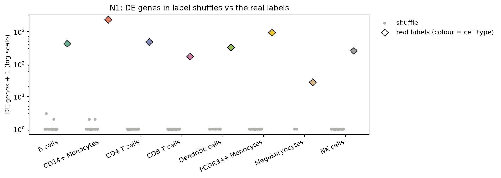

*DE genes with shuffled vs real condition labels (N1).*
- Grey: within-donor label swaps, every distinct split once (35 for 8 donors, 10 for DCs, 3 for megakaryocytes); diamonds: real labels. [Full legend](figures/CAPTIONS.md)

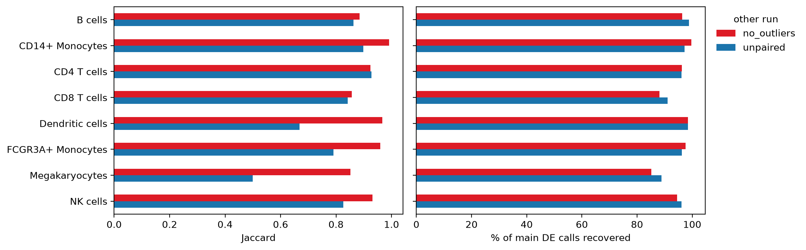

*Agreement of DE calls with two sensitivity analyses (R2, R3).*
- Left: Jaccard with the unpaired design (blue) and without the 514 outlier cells (red); right: % of main calls recovered. [Full legend](figures/CAPTIONS.md)

---

### Technical patterns

> ⚠️ **Analysis caveat (I6, DE): per-donor effect sizes are larger in smaller samples.**
> - Spearman with log n_cells down to −0.96 in B cells; megakaryocytes have the largest effects (5.3–7.5).
> - Most likely a low-count effect: in a small sample each count is a big step in CPM, so per-donor fold changes swing further.
> - It doesn't affect the DE calls, which DESeq2 fits across all donors with count noise modelled; the shuffles and LODO are clean.

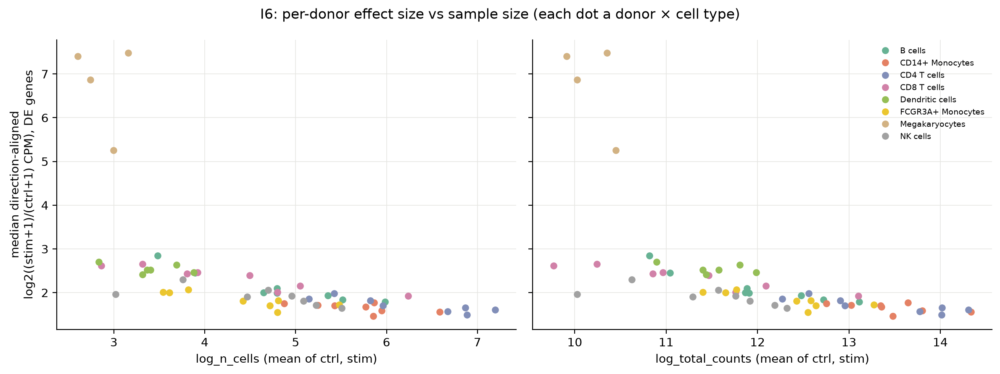

*Per-donor effect size vs pseudobulk sample size (I6).* [Full legend](figures/CAPTIONS.md)

> ⚠️ **Analysis caveat (I6, signature scores): does a cell score higher just because it got more reads?**
> - Method: each dot a cell; correlations within one cell type × condition, since pooling would mix in the IFN effect.
> - **Control cells: no** (Spearman ≈ 0–0.1 in most cell types; control DCs up to 0.46 on the IFN-γ scores).
> - **Stimulated myeloid cells: yes, partly** (CD14+ monocytes 0.56, DCs 0.64).
>   - Either biology causes depth (a strongly responding cell makes lots of ISG mRNA, adding counts) or depth inflates the score. The plot can't tell which, so it is reported, not judged.
> - **What this means for Fig 3:** depth can't explain the rise itself, because per-cell total counts barely differ between ctrl and stim (≈ 1.0–1.1, [M0](#m0-eda-and-qc)).
>   - It may inflate *how much* stimulated myeloid cells rise relative to lymphocytes. A rank-based score (e.g. UCell) would test this; not done.

---

## 4. Biological Findings

### Canonical ISGs (sanity check)

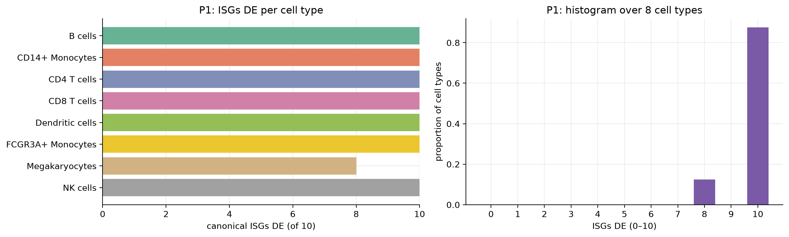

*Canonical ISGs called DE per cell type (P1).*
- Number of the 10 canonical ISGs (ISG15, IFI6, IFIT1, IFIT2, IFIT3, MX1, OAS1, RSAD2, IRF7, STAT1) DE in each cell type. [Full legend](figures/CAPTIONS.md)

- **All 10 canonical ISGs are DE in 7 of 8 cell types; megakaryocytes 8 of 10.**
  - → Expected: these genes go up wherever IFN-β signals. A failure here would mean a broken pipeline, not biology.

---

### IFN signature scores (Fig 3)

*Notebook: `notebooks/m3_signature.ipynb`*

**Why**
- The first and most obvious check: IFN-β should switch on interferon-stimulated genes (ISGs) in every cell type.

**Background: type I vs type II interferon**
- **Type I (IFN-α/β):** binds IFNAR → the ISGF3 complex (STAT1/STAT2/IRF9) → ISRE-driven genes, mostly antiviral (ISG15, IFITs, MX1, OAS).
- **Type II (IFN-γ):** binds IFNGR → STAT1 homodimers (GAF) → GAS-driven genes for immune activation (MHC class II, CIITA, CXCL9).
- **They overlap** because both use STAT1: 73 genes are in both Hallmark sets.
- → Scoring IFN-γ as a control asks whether IFN-β turns on only the type I program, or the type II program too.

**Method**
- **Gene sets: MSigDB 2026.1 Hallmark** IFN-α response (97 genes) and IFN-γ response (200).
  - MSigDB Hallmark = 50 curated gene sets, each summarising one well-defined biological process, built by condensing many overlapping published sets.
  - Used because it is a fixed, published set: the signature can't be circular with our own DE genes.
  - Both 100% found after mapping 6 renamed genes (e.g. RIGI = DDX58).
- **Score: scanpy `score_genes`** (the approach of Seurat's `AddModuleScore`; not UCell).
  - For each cell: mean expression of the set's genes minus the mean of control genes drawn from the same expression bins (50 control genes per gene, 25 bins; counts normalised to 10,000 per cell, log1p).
- **IFN-γ control:** scored on the full set and on the set without the 73 genes shared with IFN-α.
- **Summary:** each donor's mean score per cell type × condition; the change is the median over donors of stim − ctrl.

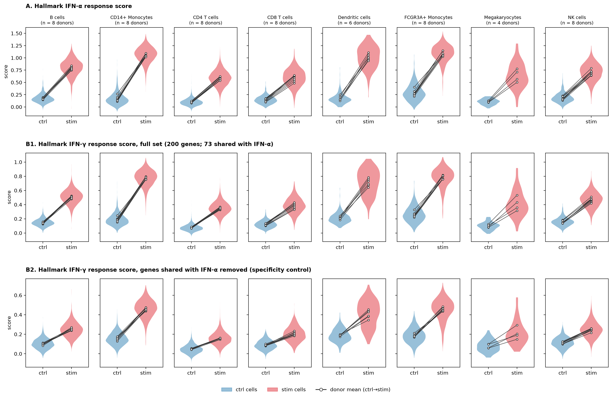

*Fig 3. IFN signature scores in control and stimulated cells, per cell type.*
- (A) Hallmark IFN-α; (B1) Hallmark IFN-γ, full set; (B2) Hallmark IFN-γ without the 73 genes shared with IFN-α. Violins: cells (24,451 in kept samples); dots: donor means joined ctrl→stim. [Full legend](figures/CAPTIONS.md)

**P5: the IFN-α score rises in every cell type** (median donor-paired stim − ctrl)

| Cell type | IFN-α | IFN-γ (full) | IFN-γ (no shared genes) |
|---|---:|---:|---:|
| CD14+ Monocytes | **0.90** | 0.59 | 0.31 |
| Dendritic cells | **0.85** | 0.51 | 0.22 |
| FCGR3A+ Monocytes | **0.81** | 0.53 | 0.28 |
| B cells | 0.62 | 0.37 | 0.15 |
| Megakaryocytes | 0.54 | 0.30 | 0.12 |
| NK cells | 0.53 | 0.31 | 0.13 |
| CD4 T cells | 0.49 | 0.28 | 0.11 |
| CD8 T cells | 0.45 | 0.27 | 0.11 |

**P6: the response is mostly type I**
- **IFN-α rises more than IFN-γ in every cell type.**
- **Removing the 73 shared genes cuts the IFN-γ rise to about a third of the IFN-α rise** (e.g. CD14+ monocytes 0.31 vs 0.90; CD4 T 0.11 vs 0.49): small, but not zero.
  - → Plausibly real spill-over: IFN-β turns on STAT1 and IRF1, which also drive part of the IFN-γ program.
- **The full IFN-γ score (B1) rises more than B2** (e.g. CD14+ monocytes 0.59 vs 0.31).
  - → Expected: the 73 shared genes are IFN-α genes, so B1 partly re-measures the type I response. B2 is what isolates the IFN-γ-only genes.
- **Read "a third" as "much smaller", not as an exact ratio:**
  - Each score is measured relative to its own set's control genes, and the two sets differ in genes, size and baseline expression.
  - So 0.31 vs 0.90 does not mean IFN-γ activity is a third of IFN-α activity in any biological unit.

**The MHC class II arm is missing**
- **CIITA (the MHC class II master regulator) and the MHC II genes are not DE in CD14+ monocytes:** CIITA 0.8, RFX5 0.8, HLA-DMA 0.4, HLA-DMB 0.3, HLA-DPB1 0.6, PSMB10 0.5 (log2FC); HLA-DMA/DMB are *down* in B cells; HLA-DR/DQ are not up in CD4 T.
- → The IFN-γ-specific part of the program (CIITA → MHC II) is absent, so the IFN-γ signature here is best explained by genes IFN-β and IFN-γ share, not by a secondary IFN-γ wave.
  - A small, late secondary wave can't be excluded at 6 h.

**Key takeaway**
- **Every cell type responds, and myeloid cells (monocytes, DCs) respond about twice as strongly as lymphocytes.**

---

### Top DE genes per cell type

*Notebook: `notebooks/m1b_de.ipynb`*

**Top 10 DE genes per cell type** (by q, then |log2FC|; all up unless marked −)

| Cell type | Top 10 |
|---|---|
| CD14+ Monocytes | ISG20, IL1RN, DYNLT1, SSB, IFITM2, TMSB10, NT5C3A, IRF7, MYL12A, OASL |
| FCGR3A+ Monocytes | APOBEC3A, ISG20, TNFSF10, IFIT3, IFIT2, OAS1, MYL12A, SSB, TMSB10, IRF7 |
| Dendritic cells | ISG15, ISG20, IFI6, IFITM3, LY6E, IRF7, MX1, OAS1, CXCL11, BST2 |
| B cells | ISG20, ISG15, LY6E, IRF7, UBE2L6, MYL12A, PSMB9, TNFSF10, IFITM2, EPSTI1 |
| CD4 T cells | ISG20, TNFSF10, PSMB9, BST2, IRF7, DRAP1, MT2A, SAT1, GBP1, UBE2L6 |
| CD8 T cells | ISG20, ISG15, IFI6, IFIT1, LY6E, IFIT3, MT2A, MX1, SAMD9, SAT1 |
| NK cells | ISG15, ISG20, IFIT1, TNFSF10, PRF1, PLSCR1, MX1, ANXA1, UBE2L6, SAT1 |
| Megakaryocytes | ISG15, ISG20, IFI6, IFIT1, IFIT2, IFIT3, FTL (−), RSAD2, FTH1 (−), LY6E |

- **The IFN response dominates:**
  - ISG20 or ISG15 is in the top 2 of every cell type; ISG15 is up in all 8 (log2FC 4.7–7.7).
  - 14–84 of the 97 Hallmark IFN-α genes are up per cell type (fewest in megakaryocytes), and no canonical ISG goes down.
  - Ribosomal genes: 0 in the top 50, except 2 in CD14+ monocytes.

#### Analysis Sanity Checks

- **Fits are clean:**
  - All 305 fits used DESeq2's parametric dispersion trend.
  - Every missing p-value is an all-zero gene.
  - Cook's filtering can't act on paired fits (every sample alone in its design cell).
- **No false-positive signal:** label shuffles give 0–2 DE genes (median 0) against 27–2,335 in the real data.
- **Sensitivity runs at a glance** (DE genes):
  - Removing outlier cells barely changes the counts (e.g. CD14+ 2,335 → 2,341).
  - The unpaired design finds more in DCs (324 → 472) and megakaryocytes (27 → 45).
  - Leaving one donor out gives 2,014–2,242 in CD14+ monocytes.
- **Technical covariates don't drive the DE calls:**
  - For DE genes, condition explains a median 57–83% of variance per cell type; `n_cells` + `total_counts` only 3–9%.
  - 197 of 4,947 DE genes (4%; 105 in CD14+ monocytes) have condition < 10%; leave-one-donor-out (R1) keeps all of their signs.
- **Pairing matters:** on a toy gene with a consistent 1.6× within-donor effect and large donor differences, the paired p is 1.3e-8 vs 0.27 unpaired.

---

### Shared vs cell-type-specific genes (Fig 4)

*Notebook: `notebooks/m2_calls.ipynb`*

**Method**
- **2,801 genes are DE** (q < 0.05, |log2FC| ≥ 1) in at least one cell type.
- Each gets a label (decisions O1–O3 and the tested-only CI rule):

| Label | Genes | Meaning |
|---|---:|---|
| **shared** | 21 | DE in all 8 cell types, same direction |
| **shared\*** | 87 | DE in all 6 well-powered cell types; DCs / megakaryocytes DE or with a tested 95% CI reaching \|log2FC\| ≥ 1 the same way |
| partial | 856 | DE in 2+ cell types, not shared |
| specific | 241 | DE in 1 cell type; no other tested cell type could hide a ≥ 2-fold effect |
| specific\* | 1,585 | DE in 1 cell type, but another tested cell type's CI reaches ≥ 2-fold, so "specific" may be a power gap |
| mixed | 11 | Up in some cell types, down in others |

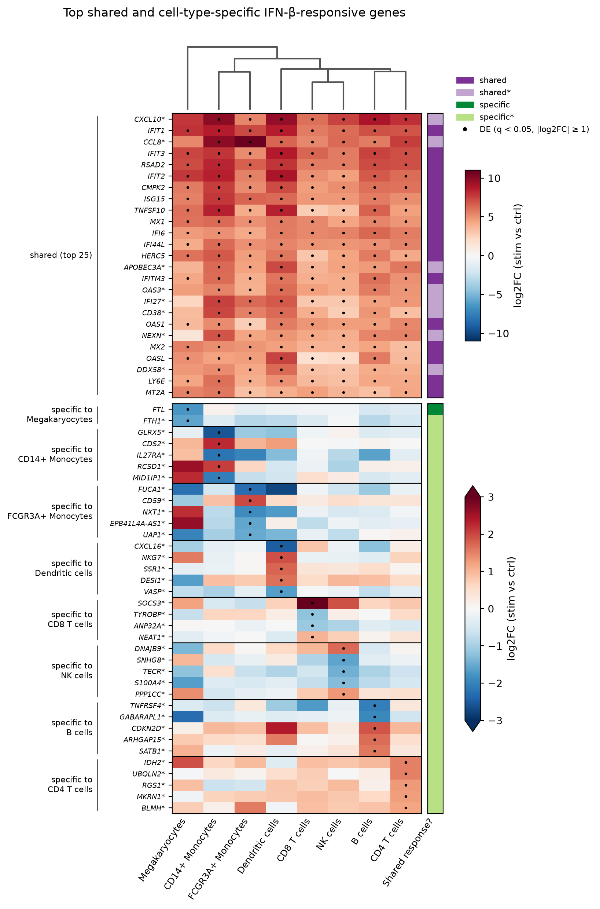

*Fig 4. Top shared and cell-type-specific IFN-β-responsive genes.*
- Top: 25 shared/shared\* genes with the largest mean |log2FC|; bottom: top 5 single-cell-type genes per cell type, among genes tested in all 8. Colour: log2FC, ±11 (shared) and ±3 (specific); dots: DE.
- Columns clustered by Jaccard similarity of up-regulated DE genes. [Full legend](figures/CAPTIONS.md)

**Results**
- **The shared response is entirely upward and is the interferon program:** all 108 shared genes go up.
  - Classic ISGs and antiviral sensors: ISG15, IFIT1/2/3/5, MX1/2, OAS1/2/3, IFI6/27/44/44L, RSAD2, STAT1, IRF7, DDX58 (RIG-I), IFIH1 (MDA5), GBP1/4/5, TRIM21/22, PARP9/12/14, CXCL10, TNFSF10 (TRAIL).
  - No ribosomal or mitochondrial genes. (Paper: 83 genes DE in all 8.)
  - Fig 4's top 25 are all ISGs or IFN-induced chemokines (CXCL10\*, CCL8\* lead).
- **Specificity is mostly monocyte specificity:** of 1,826 single-cell-type genes, 1,423 are CD14+ monocytes.
  - Then FCGR3A+ monocytes 132, CD4 T 121, B 86, DCs 29, NK 26, CD8 T 7, megakaryocytes 2.
  - The most common multi-cell-type pattern is both monocyte types together (388 genes); next, the six well-powered cell types + DCs (87, i.e. everything but megakaryocytes).
- **Mixed-direction genes (11)** are myeloid/inflammatory: AOAH, CCL22, ITGB2, MAP3K8, NCF1, TRIB1, …
- **Robustness:** 100% of the 4,947 DE calls keep their sign in every leave-one-donor-out refit.

**Interpretation**
- → **"Specific" usually can't be claimed outright:** 1,585 of 1,826 carry the star, because another cell type's estimate is too uncertain to rule out a 2-fold change. Clean "specific" calls: 241.
- → **Clean "specific" mostly means specific *expression*, not a specific *response*.**
  - 229 of the 241 clean `specific` genes are expressed (tested, baseMean > 1) only in their own cell type, e.g. KRT81/KRT86 in NK, CX3CR1 in FCGR3A+ monocytes. No other cell type could show a change, so no CI can add a star.
  - Genes that **every** cell type expresses but only one changes are all `specific*` (333 genes, e.g. IL27RA in CD14+ monocytes, CXCL16 in DCs, S100A4 in NK). The response looks cell-type specific, but another cell type's estimate can't rule out a 2-fold change.
  - Fig 4 shows this second kind (decision F3): every specific gene shown except FTL is `specific*`, with |log2FC| 1.0–3.3 (largest: SOCS3 in CD8 T, +3.3); CD8 T has 4 such genes, megakaryocytes 2 (FTL, FTH1\*, both down).

> ⚠️ **Analysis caveat:** megakaryocytes (4 paired donors) and dendritic cells (6) have less power than the other six cell types, so a gene missing there may be a power gap, not biology. The specific\* and shared\* labels handle this, and the 27 megakaryocyte calls are flagged lower confidence.

> ⚠️ **Analysis caveat: ambient RNA is not corrected.** Free mRNA, mostly from monocytes, is captured in other cells' droplets, so a few monocyte genes appear to "respond" in lymphocytes and megakaryocytes.
> - 2–6% of lymphocyte DE genes (megakaryocytes 7 of 27) are ≥ 20× higher in monocytes at baseline and change in the same direction as in monocytes.
> - Among the 108 shared genes: CXCL10, CCL2, CCL8, APOBEC3A.

---

### Shared programs (Fig 5)

*Notebook: `notebooks/m2c_programs.ipynb`*

**Why**
- Common **programs**, not only common genes: two cell types can respond with different genes from the same pathway.

**Method**
- **Top genes:** the top 20 up and down DE genes per cell type, and how many cell types share each.
- **Programs:** GSEA (`fgsea`) on Hallmark + KEGG gene sets, genes ranked by DESeq2's Wald statistic, BH < 0.05 within each cell type.

**Top 20 genes shared across cell types**
- **Up:** ISG20 is in the top 20 of all 8 cell types.
  - IRF7, ISG15, PLSCR1, SAT1, TNFSF10 in 6; IFI6, IFIT3, LY6E, MX1, OASL, TMSB10, UBE2L6 in 5.
- **Down: barely shared.**
  - IL8 in 5 cell types: CD4 T, dendritic cells, FCGR3A+ monocytes, megakaryocytes, NK.
  - GLIPR1 in 4: B, CD14+ monocytes, dendritic cells, FCGR3A+ monocytes.
  - Nothing else in more than 3.

**What goes down** (our DE, `m1b_de.csv`)
- **Down DE genes:** CD14+ monocytes 1,116; FCGR3A+ 319; CD4 T 105; B 89; DCs 52; NK 40; CD8 T 10; megakaryocytes 4.
- **Strongest in CD14+ monocytes** (log2FC −4 to −5): VCAN, CD93, CLEC5A, THBD, MMP9, HBEGF, TPST1.
  - → Classical-monocyte, inflammatory and tissue-remodelling genes: IFN-β shifts monocytes away from their resting inflammatory state.
- **Strongest in CD4 T cells:** IL1B, IL8, CD14, AOAH.
  - → These are monocyte genes, so likely ambient RNA, not T-cell biology (see the [ambient-RNA caveat](#ambient-rna)).
- **Down programs, by number of cell types:** KEGG ribosome 8, MYC targets 5, oxidative phosphorylation 4, glycolysis 3.
  - → Down-regulation is mostly growth and metabolism, not a second shared gene list.

> ⚠️ **Analysis caveat:** IL8 down in CD4 T, NK and megakaryocytes is flagged as likely ambient RNA (see the [ambient-RNA caveat](#ambient-rna)).

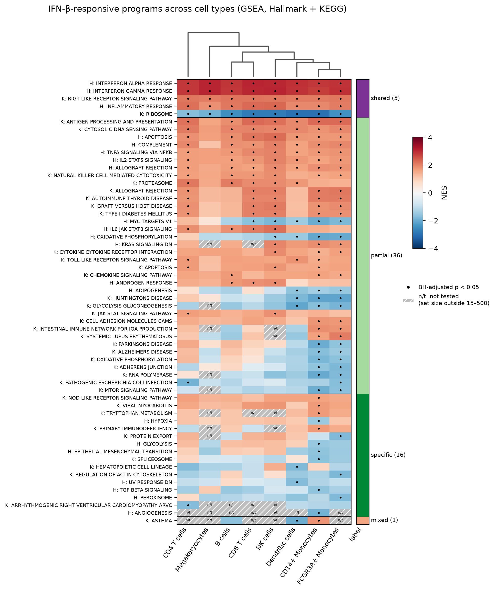

*Fig 5. Response programs across cell types (GSEA).*
- 58 Hallmark (H) and KEGG (K) sets with BH-adjusted p < 0.05 in at least one cell type, grouped by label. Colour: normalised enrichment score (±4); dots: significant; n/t: not tested.
- Columns clustered by correlation of NES profiles. [Full legend](figures/CAPTIONS.md)

**Programs** (58 affected somewhere; 30 program × cell type cells untested, `n/t`)

| Label | Programs | Examples |
|---|---:|---|
| **shared** | 5 | **Up in all 8:** Hallmark IFN-α response, IFN-γ response, inflammatory response, KEGG RIG-I-like receptor signalling. **Down in all 8:** KEGG ribosome |
| partial | 36 | Up in 7: allograft rejection, apoptosis, complement, IL2–STAT5, TNFα–NFκB, antigen processing, cytosolic DNA sensing. Down in several: oxidative phosphorylation, MYC targets |
| specific | 16 | Mostly CD14+ monocytes: **up** NOD-like receptors, tryptophan metabolism (IDO1), primary immunodeficiency, viral myocarditis; **down** hypoxia, glycolysis, TGF-β, EMT, angiogenesis, spliceosome |
| mixed | 1 | KEGG asthma (up in CD14+ monocytes, down in DCs) |

**Interpretation**
- **KEGG ribosome is down in all 8 cell types:** NES −1.7 (CD4 T) to −3.0 (DCs), BH-adjusted p ≤ 0.009.
  - **But each ribosomal-protein gene drops only a little:** median log2FC from +0.01 (CD4 T) to −0.39 (CD14+ monocytes), i.e. 0–24% lower; 0–10 of 93 are called DE per cell type.
  - GSEA (NES) detects that the whole set shifts together, even when no single gene passes the DE cut.
- **PKR (EIF2AK2) is up 8–26× (log2FC 3.0–4.7)** in every cell type (DE in 7; not megakaryocytes).
- → **The shared program is antiviral interferon signalling plus a small, coordinated dip in ribosomal-protein mRNA.** "Shutdown" would overstate it.
  - Cause untested. DESeq2's median-of-ratios size factors are built to resist a minority of strongly changing genes, so this isn't simply ISGs taking a larger share of reads. It could be real down-regulation, a subtler compositional effect, or a run difference ([caveat 1](#analysis-caveats-recap)).
  - M0's drop in % ribosomal reads is a raw share of reads, which ISGs taking over the library would lower on its own, so it agrees in direction but isn't independent support.
  - PKR blocks translation at the protein level (it phosphorylates eIF2α); it does not lower ribosomal mRNA, so it fits the antiviral picture but doesn't explain this dip.
- **CD14+ monocyte-only programs** (NES, BH-adjusted p):
  - **Up:** KEGG NOD-like receptor signalling (1.61, 0.036), led by CCL2, CCL7, CCL8, CCL5, IL6, CASP1, RIPK2; KEGG tryptophan metabolism (1.72, 0.020), led by IDO1, IL4I1, WARS, KYNU.
  - **Down:** glycolysis (Hallmark −1.53, 0.008; KEGG −1.70, 0.020), led by ENO1, TPI1, GAPDH, PKM, PGK1, LDHA; hypoxia (−1.47, 0.021), sharing ENO1, TPI1, GAPDH; TGF-β (−1.61, 0.044), led by ENG, ID2, ID3, THBS1.
- **IDO1 itself is up in 7 of 8 cell types** (log2FC 6.4 in CD14+, 5.9 FCGR3A+, 1.9–5.1 elsewhere); only the tryptophan-pathway *set* is CD14+-only.
- → **CD14+ monocytes add a chemokine and tryptophan-catabolism program, and lower glycolysis.**
  - The "NOD-like receptor" set is driven by chemokines and inflammasome parts (CASP1), not by the NOD receptors (NOD2 isn't DE anywhere).
  - Hypoxia and glycolysis share their leading genes, so they are one signal, not two.
  - TGF-β is borderline (p 0.044).
  - "Specific" partly reflects power: CD14+ has the most cells and the longest DE list (2,335 genes).

---

### How cell types group

**Method**
- Two dendrograms:
  - **Fig 4:** Jaccard similarity of the cell types' up-regulated DE gene sets.
  - **Fig 5:** correlation of the cell types' program (NES) profiles.

**Results**
- **By shared up-regulated genes (Fig 4):** monocytes (CD14+ with FCGR3A+, J = 0.44) | lymphoid cells + DCs (NK–CD8 T most alike, J = 0.59; B with CD4 T) | megakaryocytes apart (J ≤ 0.14).
  - Down-regulated genes barely overlap anywhere (J ≤ 0.06, except monocytes 0.17).
- **By programs (Fig 5):** {B, CD8 T} | {both monocytes, DCs, NK} | megakaryocytes | CD4 T.
  - CD4 T stands apart because oxidative phosphorylation and MYC targets go *up* there, down elsewhere.
- **The two groupings disagree** (decision F5 shows both).

**Interpretation: which grouping makes more sense?**
- → **Fig 4 (genes) is partly lineage-like.**
  - The two monocyte types pair (both myeloid), CD8 T pairs with NK (both cytotoxic lymphocytes), and megakaryocytes are the outgroup (not leukocytes; few DE genes).
  - But **DCs sit with the lymphocytes**, which no lineage tree supports (DCs are myeloid).
  - Likely reason: DCs and lymphocytes have short DE lists made mostly of the shared ISG core, so they overlap heavily with each other; the monocytes' long lists (2,335 genes in CD14+) are full of their own genes and overlap less with anyone.
  - So the tree tracks *how much of a cell type's response is the shared core*, and power (DCs have 6 donors), as much as biology.
- → **Fig 5 (programs) is the more informative grouping for "which cell types respond alike".**
  - It uses every tested gene (no DE threshold), counts down-regulated programs too, and is less sensitive to list size and donor number.
  - Its innate block (monocytes, DCs, NK) is biologically sensible: shared inflammatory and complement programs; NK cells are innate lymphocytes.
  - CD4 T stands apart because of its opposite-direction metabolic programs (OXPHOS, MYC targets up).
  - The B–CD8 T pair has no clear explanation.
- → **Why they differ:**
  - Different units (individual genes vs gene sets).
  - A threshold (DE calls) vs none (ranked statistics).
  - Up only vs both directions.
  - Different similarity measures: Jaccard is penalised by unequal list sizes; correlation compares profile *shape*, not magnitude.
    - Shape = which programs go up or down, and by how much relative to the cell type's other programs. Two cell types with the same pattern at different strengths get r = 1.
    - Magnitude is left out on purpose: NES grows with statistical power (donors, cells) as well as with response size. A distance on magnitude would group DCs (6 donors) and megakaryocytes (4) as "weak responders", and the monocytes as "strong", whatever their programs.
    - Response size is shown separately: Fig 3 and the heatmap colours.
  - The shared ISGs count several times in Fig 5, because the Hallmark IFN-α and IFN-γ sets overlap by 73 genes.

> ⚠️ **Analysis caveat:** neither tree is validated independently.

---

### Final table

*Notebook: `notebooks/w4_figures_table.ipynb` (display only: every number is read from M3, M2a or M2c and asserted equal to its source)*

- **`results/final_table.csv`** (columns in [`results/README.md`](results/README.md)): 2,801 genes × 8 cell types (↑ / ↓ / –), `Shared response?`, `expressed_in_n_cell_types`, log2FC and q per cell type.
  - shared 21, shared\* 87, partial 856, mixed 11, specific 241, specific\* 1,585.
  - Top rows: IFIT1, IFIT3, RSAD2, IFIT2, CMPK2, ISG15, TNFSF10, MX1.
- **Fig 4's specific rows are restricted to genes tested in all 8 cell types** (F3 revised), because 229 of 241 clean `specific` genes are expressed only in their own cell type.

---

## Analysis caveats: recap

1. **Condition is confounded with the 10x run** ([Design](#m0-eda-and-qc)).
   - Control and stimulated cells were each pooled and run separately, so every DE call compares run 1 with run 2 as well as control with IFN-β.
   - Any run-specific difference (chemistry or reagent lot, capture efficiency, sequencing depth, ambient RNA profile) would look exactly like a response to IFN-β, and the data can't tell the two apart.
   - Pairing by donor removes donor differences, not run differences. The ISG response is too large and too specific to be a run artifact; smaller changes (e.g. metabolic programs, the ribosome dip) are less certain.
2. **No % mito**, so low-quality cells can't be confirmed as damaged ([The data](#m0-eda-and-qc)).
3. **Megakaryocytes (4 paired donors) and dendritic cells (6) have less power**, so a gene missing there may be a power gap, not biology ([Fig 4](#shared-vs-cell-type-specific-genes-fig-4)).
4. **Ambient RNA is not corrected:** a few monocyte genes (e.g. APOBEC3A, CCL2/CCL8 in B and NK, IL1B/IL8 in lymphocytes) appear as DE in other cell types ([Fig 4](#ambient-rna)).
5. **"Specific" often means expressed in only one cell type, not a cell-type-specific response** ([Fig 4](#shared-vs-cell-type-specific-genes-fig-4)).
   - 229 of the 241 clean `specific` genes are expressed (tested) only in their own cell type, so the other cell types couldn't show a change.
   - These calls say *where* a gene responds, not that other cell types respond differently. A cell-type-specific response is shown only by genes every cell type expresses but only one changes (the `specific*` rows in Fig 4), and none is tested as a difference between cell types.
6. **The donors are lupus patients**, whose cells may already carry an interferon signature at baseline, so effect sizes (and possibly some genes) may not carry over to healthy PBMCs.
