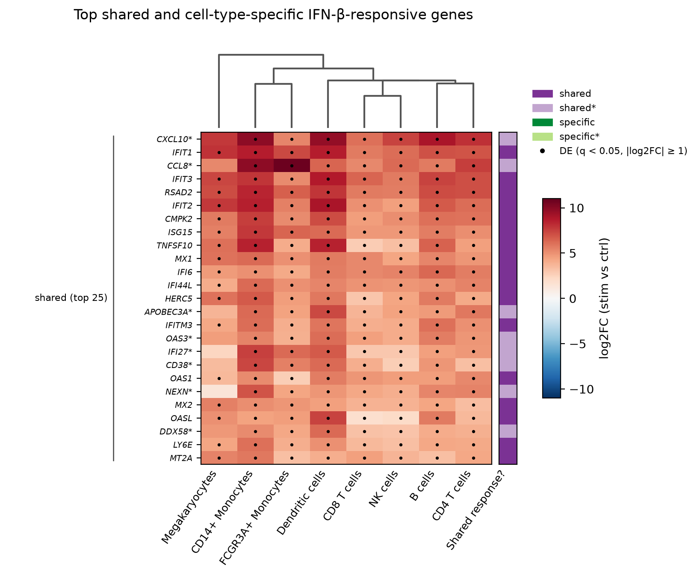
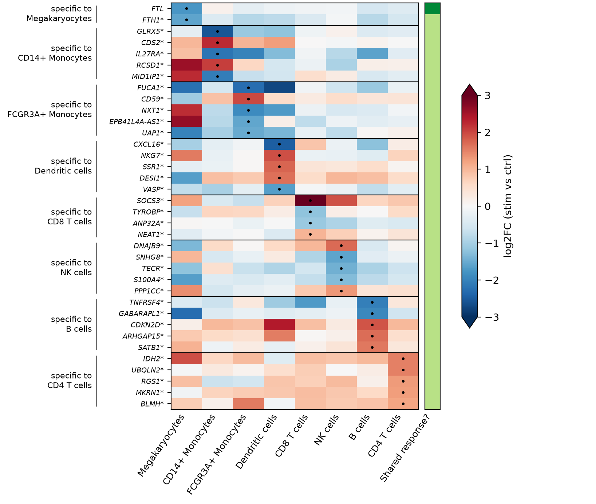

# IFN-β across immune cell types: shared and cell-type-specific responses

**Question:** Which transcriptional responses to IFN-β are shared across PBMC cell types, and which are cell-type specific?

**Key insight:** Every cell type turns on the same antiviral interferon program; monocytes add a large response of their own on top of it.

<table>
<tr>
<td width="50%"></td>
<td width="50%"></td>
</tr>
<tr>
<td><b>Shared:</b> the top 25 shared genes (log2FC, stimulated vs control) go strongly up in all 8 cell types.</td>
<td><b>Specific:</b> genes DE in only one cell type change modestly.</td>
</tr>
</table>

---

## 1. Goal

**Why ask this**

- **IFN-β** is a type I interferon, released by infected cells early in a viral infection. Through its receptor (IFNAR → JAK1/TYK2 → STAT1–STAT2–IRF9) it switches on hundreds of **interferon-stimulated genes (ISGs)**: antiviral effectors (ISG15, IFITs, MX1, OAS), viral-RNA sensors (RIG-I, MDA5) and chemokines.

- Almost every immune cell carries IFNAR, so **one signal coordinates the whole immune response**:
  - a **shared** response puts every cell into a common antiviral state.
  - **cell-type-specific** responses turn the same signal into different jobs (antigen presentation, recruiting other cells, killing).

- Separating the two shows what IFN-β does everywhere and what depends on the cell receiving it. This matters in two places:
  - **IFN-β as a drug** (a multiple sclerosis therapy): which of its effects reach which cells.
  - **Lupus**, where many patients' blood cells keep ISGs switched on even without infection (the “interferon signature”). Knowing which ISGs come from which cell type helps read that signature in patient blood. The donors here are themselves lupus patients.

**The data:** Kang et al. 2018, *Multiplexed droplet single-cell RNA-sequencing using natural genetic variation*, Nat Biotechnol 36:89–94 ([doi:10.1038/nbt.4042](https://doi.org/10.1038/nbt.4042)).

**The second goal: an AI workflow a scientist can trust**

- The analysis was built with AI agents (Claude Code and Codex), in a workflow that **reported every step to me and stopped for my validation at key points**.

- **A common worry among scientists is that AI confidently produces wrong outputs**: a mis-joined table, a silently dropped group, a default parameter nobody chose. **Here every choice that could change a number came back to me as a question**, and every result-producing module was checked by a different model from the one that wrote it.

- I stayed in control of the whole process and still collaborated with AI throughout ([How this was built with AI](#7-how-this-was-built-with-ai)).

---

## 2. Data

- **Design:** peripheral blood mononuclear cells (PBMCs) from **8 lupus patients**, split into a control sample and a sample stimulated with recombinant IFN-β for 6 hours. Each condition was pooled across donors and run on 10x Genomics droplets. Donors were assigned to cells from their natural genetic variation (demuxlet), which also removes doublets.
- **Size:** 24,673 singlet cells × 15,706 genes, as raw integer counts. After the basic filters (cells with ≥ 200 genes, genes in ≥ 3 cells): **24,562 cells × 15,701 genes**.
- **Sources:** the count matrix from the [pertpy h5ad](https://scverse-exampledata.s3.eu-west-1.amazonaws.com/pertpy/kang_2018.h5ad). **Cell-type labels are the authors'**, from GEO [GSE96583](https://www.ncbi.nlm.nih.gov/geo/query/acc.cgi?acc=GSE96583) (`batch2.total.tsne.df.tsv`). The h5ad's own labels are a later re-analysis that agrees with the authors' on only 91% of cells.
- **Join trap:** 234 barcode sequences occur in both the control and stimulated runs, and the two tables suffix them differently. A join on the raw barcode silently matches only control cells. Joining on (barcode sequence, condition) matches all 24,673 cells, with donor, cluster and t-SNE coordinates agreeing 100%.
- **Cells per donor** range from 992 to 5,090, and every donor has both conditions.

> **Limit of the design:** each condition was a single pool and a single 10x run, so condition is confounded with the run. A run effect cannot be separated from IFN-β; this caveat applies to every result below.

Full facts (columns, label spellings, group sizes): [`audit/data_facts.md`](audit/data_facts.md).

---

## 3. Cell types

All 8 of the authors' cell types are analysed. Differential expression (DE) needs a donor with ≥ 10 cells in **both** conditions (a "paired donor"). Two cell types fall short for some donors, which lowers their statistical power.

| Cell type | What it is | Typical markers | Paired donors |
|---|---|---|---:|
| CD4 T cells | Helper T cells; coordinate other immune cells through cytokines | CD3E, IL7R | 8 |
| CD8 T cells | Cytotoxic T cells; kill infected cells | CD3E, CD8A | 8 |
| B cells | Make antibodies; present antigen | MS4A1, CD79A | 8 |
| NK cells | Innate lymphocytes; kill infected cells without prior priming | GNLY, NKG7 | 8 |
| CD14+ Monocytes | Classical monocytes; phagocytose, make inflammatory cytokines | CD14, LYZ | 8 |
| FCGR3A+ Monocytes | Non-classical (CD16+) monocytes; patrol blood vessels | FCGR3A, MS4A7 | 8 |
| Dendritic cells | Present antigen to T cells | FCER1A, CST3 | **6** |
| Megakaryocytes | Platelet precursors (in blood samples this cluster may partly be platelets) | PPBP, PF4 | **4** |

The descriptions and markers are textbook knowledge, not results of this analysis. The paired-donor counts come from [`FINDINGS.md`](FINDINGS.md#m0-eda-and-qc).

---

## 4. Key results

Convention: a **bold line** is a measurement; an indented → line is what it may mean.

Method in brief: pseudobulk counts per donor × cell type × condition, then DESeq2 `~ donor + condition` (paired by donor), with FDR from `qvalue` per cell type, as in Kang 2018. A gene is **DE** if q < 0.05 and |log2FC| ≥ 1.

### Fig 3: the interferon signature rises everywhere, most in myeloid cells


1. **The IFN-α signature rises in every donor of every cell type**, by about twice as much in monocytes and DCs (median score change 0.81–0.90) as in lymphocytes (0.45–0.62).
   → The response is shared but graded: myeloid cells respond most strongly.

### Fig 4: a shared gene core, plus a large monocyte-specific response


2. **Every cell type shares an upward interferon core.** 108 genes are shared: 21 are DE in all 8 cell types and 87 more are DE in the 6 well-powered cell types (with DCs and megakaryocytes consistent). All 108 go up. They are classic ISGs (ISG15, IFIT1/2/3, MX1, OAS1/2/3, IFI6, RSAD2, STAT1, IRF7, DDX58), and none is ribosomal or mitochondrial.
   → One antiviral program, switched on in every cell that receives IFN-β.
3. **CD14+ monocytes have by far the largest response:** 2,335 DE genes, about half of them down, compared with 27–919 in the other cell types. Of the 1,826 genes DE in only one cell type, 1,423 are in CD14+ monocytes.
   → Most cell-type-specific biology is in the monocytes. Lymphocytes mainly run the shared core.
   - Caveat: this counts genes, not tested differences. Of the 1,423, 186 are cleanly specific, and most of those are expressed only in monocytes (178 of the 1,423 are), which shows *where* the response happens, not that other cell types respond differently to the same gene. The other 1,237 are `specific*`: another cell type's estimate still allows a ≥ 2-fold change.
4. **Most "specific" calls cannot be claimed outright.** For 1,585 of the 1,826 single-cell-type genes, another cell type's 95% confidence interval still allows a ≥ 2-fold change. Only 241 are cleanly specific.
   → A gene missing from one cell type's list is often a power gap, not an absent response.

### Fig 5: the same picture at the level of programs


5. **Programs (gene-set enrichment, Hallmark + KEGG) show the same picture.** IFN-α, IFN-γ, inflammatory response and RIG-I signalling go up in all 8 cell types, and the ribosome program goes down in all 8. CD14+ monocytes add their own programs: NOD-like receptors and tryptophan metabolism (IDO1) up; glycolysis, hypoxia and TGF-β down.

### Validation

6. **The calls hold up:**
   - shuffled condition labels give 0–2 DE genes, against 27–2,335 with the real labels.
   - 100% of the 4,947 DE calls keep their sign when any one donor is left out.
   - 82–96% of our DE genes are also in the paper's tables, and **0 have the opposite sign**.

**Caveats**
- Condition is confounded with the 10x run.
- Ambient RNA is not corrected. Free mRNA, mostly from monocytes, ends up in other cells' droplets, so a few monocyte genes (e.g. APOBEC3A, CCL2/CCL8 in B and NK cells) appear to "respond" in other cell types.
- DCs and megakaryocytes have fewer paired donors (6 and 4), so these two cell types have less power.
- The donors are lupus patients, whose cells may already carry an interferon signature at baseline, so effect sizes may not carry over to healthy PBMCs.

Full results and every figure: [`FINDINGS.md`](FINDINGS.md), [`figures/CAPTIONS.md`](figures/CAPTIONS.md). The final gene × cell-type table is [`results/final_table.csv`](results/final_table.csv), with its columns described in [`results/README.md`](results/README.md).

---

## 5. Repository

```
├── src/                      Python logic, one file per module (m0_qc.py … w4_outputs.py)
├── R/                        DESeq2 + qvalue DE, variance partitioning, fgsea
├── notebooks/                analysis notebooks (.py source + executed .ipynb)
│   ├── 00_eda, m1a_…, m1b_de, m2_calls, m2_validation, m2c_programs, m3_signature, …
│   └── *_explained           explained-by-example: tiny inputs, expected vs real output
├── tests/                    pytest suite (99 tests)
├── figures/                  Figs 1–5 + diagnostics; CAPTIONS.md holds every legend
├── results/                  final_table.csv (gene × cell type) + column guide
├── audit/
│   ├── data_facts.md         what the data actually contains; agents read it, never guess
│   ├── decisions.md          every decision the user made, with its reason
│   ├── qc_flags.md           everything concerning, with a proposed action for the user
│   ├── cell_flow.md          cells in → cells out at every filter, join and aggregation
│   ├── contracts/            one-page spec per module, approved before coding
│   ├── test_plans/           tests the user approved before any were written
│   ├── reviews/              Codex reviews and reviewer briefs (md + html)
│   ├── ledger.md             audit status of every behaviour
│   ├── planted_bugs.md       deliberately planted bugs and whether they were caught
│   └── validation_plan.md / validation_report.md
├── scripts/md2html.py        renders briefs to HTML with clickable file:line links
├── FINDINGS.md               results: EDA/QC, concordance, validation, biology
├── CLAUDE.md                 the rules every agent follows (AGENTS.md → same file, for Codex)
├── LICENSE                   MIT (code); data under the original authors' terms
└── data/                     downloaded inputs (git-ignored; see Setup)
```

Each folder has its own `README.md` describing its contents.

---

## 6. Setup

```bash
# Python 3.11
uv venv --python 3.11 .venv
uv pip install --python .venv --only-binary llvmlite,numba -r requirements.txt

# R 4.3 + Bioconductor (DESeq2 1.40.2, qvalue 2.32.0, variancePartition 1.30.2, fgsea 1.26.0)
Rscript -e 'BiocManager::install(c("DESeq2", "qvalue", "variancePartition", "fgsea"))'

# tests
.venv/bin/python -m pytest tests/
```

- `--only-binary` is needed on Intel Macs, which have no recent `llvmlite` wheel. Without the flag, pip tries to build from source and fails without CMake.
- **Data** (into `data/`, which is git-ignored):
  - `data/kang_2018.h5ad`: [pertpy example data](https://scverse-exampledata.s3.eu-west-1.amazonaws.com/pertpy/kang_2018.h5ad). Load it with `anndata.read_h5ad`; `import pertpy` 1.0.3 fails with statsmodels 0.15.
  - `data/geo/GSE96583_batch2.total.tsne.df.tsv.gz`: the authors' cell metadata, from [GEO GSE96583](https://www.ncbi.nlm.nih.gov/geo/query/acc.cgi?acc=GSE96583).
  - `data/msigdb/`: MSigDB 2026.1 Hallmark and KEGG legacy `.gmt` files.
  - `data/kang2018_supp/`: the paper's supplementary tables, used for comparison only.
- Python writes pseudobulk counts and sample metadata to files; the R scripts read them and write their results back to files.

---

## 7. How this was built with AI

Built with [Claude Code](https://claude.com/claude-code) and [Codex](https://openai.com/codex). **Two independent agents checked each other, and I made every decision.** In this kind of analysis a bug doesn't crash: it puts a plausible, wrong number into a table.

The diagram is the whole process, from question to README. Box ② zooms in on one module. *Italics* are the files each step writes.

```mermaid
flowchart TB
    SPEC["<b>Human</b><br/>question, outputs, rules<br/><i>CLAUDE.md</i>"]

    subgraph E["⓪ know the data · Wave 0"]
        direction LR
        EDA["<b>Claude</b><br/>visual EDA<br/><i>notebooks/00_eda.ipynb</i>"] --> FACTS["<b>Claude</b><br/>facts + flags<br/><i>audit/data_facts.md<br/>audit/qc_flags.md<br/>audit/cell_flow.md</i>"]
        FACTS --> QC["<b>Human</b><br/>keeps / drops,<br/>sets pass criteria<br/><i>audit/validation_plan.md</i>"]
    end

    subgraph D["① decide the approach · every module"]
        direction LR
        CON["<b>Claude</b><br/>contract + decision cards<br/><i>audit/contracts/M.md</i>"] --> TP["<b>Codex</b><br/>test plan, blind;<br/>then Claude adds<br/><i>audit/test_plans/M.md</i>"]
        TP --> CMP["<b>Human</b><br/>decides, approves contract<br/>+ 5–10 tests<br/><i>audit/decisions.md</i>"]
        CMP -. iterate .-> CON
    end

    subgraph B["② build it · zoom in on one module"]
        direction TB
        T["<b>Codex</b><br/>writes the tests first<br/><i>tests/test_m.py</i>"] --> IMPL["<b>Claude</b><br/>writes code, runs tests<br/><i>src/m.py · R/m.R<br/>notebooks/m.ipynb</i>"]
        IMPL --> REV["<b>Codex</b><br/>reviews the code<br/><i>audit/reviews/0NN_M_codex_review.md</i>"]
        REV -. defect .-> FIX["<b>Claude</b><br/>fix + test that fails on old code<br/><i>tests/test_m_review.py</i>"]
        FIX -.-> RECHK["<b>Codex</b><br/>re-checks fixes,<br/>re-runs full suite"]
        REV --> RECHK
        RECHK --> PLANT["<b>Claude</b> plants a bug<br/><b>Codex</b> reviews, not told<br/><i>audit/reviews/0NN_M_codex_planted_review.md<br/>audit/planted_bugs.md</i>"]
        PLANT --> BRIEF["<b>Codex</b><br/>reviewer brief<br/><i>audit/reviews/0NN_M_codex_reviewer_brief.md + .html</i>"]
        PLANT --> EX["<b>Claude subagent</b><br/>explained by example<br/><i>notebooks/m_explained.ipynb</i>"]
    end

    subgraph G["③ gate · after every wave"]
        direction LR
        PKG["return package<br/><i>FINDINGS.md section<br/>figures/ + CAPTIONS.md<br/>audit/ledger.md</i>"] --> GATE["<b>Human</b><br/>reads brief, examples, outputs;<br/>decides; merges"]
    end

    subgraph W["④ write it up"]
        direction LR
        DRAFT["<b>Claude</b> drafts, re-checks numbers<br/><i>FINDINGS.md · README.md</i>"] --> EDIT["<b>Human</b><br/>directs the story,<br/>cuts, challenges"]
        EDIT -. iterate .-> DRAFT
    end

    SPEC --> EDA
    QC --> CON
    CMP --> T
    BRIEF --> PKG
    EX --> PKG
    GATE -. "next wave<br/>≤ 3 modules in parallel" .-> CON
    GATE --> DRAFT
    EDIT --> OUT["public repo"]
    GATE -.->|"lesson<br/>worth keeping"| RULES["<b>CLAUDE.md</b><br/>+ skills"]
    RULES -.-> CON

    classDef h fill:#e8efe9,stroke:#6a9c78,color:#26302b
    classDef c fill:#eef2f6,stroke:#5b7fa6,color:#22303d
    classDef x fill:#f6eeee,stroke:#a66b5b,color:#3d2622
    classDef r fill:#f4f1e8,stroke:#a89a6b,color:#332e20
    classDef o fill:#ffffff,stroke:#8a8f8c,color:#26302b
    class SPEC,QC,CMP,GATE,EDIT h
    class EDA,FACTS,CON,IMPL,FIX,EX,DRAFT c
    class TP,T,REV,RECHK,BRIEF x
    class PLANT,RULES r
    class PKG,OUT o
    style E fill:#fbfbf9,stroke:#d8dcd9
    style D fill:#fbfbf9,stroke:#d8dcd9
    style B fill:#fbfbf9,stroke:#d8dcd9
    style G fill:#fbfbf9,stroke:#d8dcd9
    style W fill:#fbfbf9,stroke:#d8dcd9
```



Colours: green = me, blue = Claude, red = Codex, yellow = the planted-bug check and the rules every agent reads. `M` / `m` stands for a module (e.g. `M1b` → `src/m1b_de.py`, `audit/reviews/007_M1b_codex_review.md`).

- **Every check is done by a different model, or at least a fresh context, from the step it checks.** Codex writes tests from the contract before any code exists, so passing means the code matches the specification, not that the tests match the code.
- **Scaled to risk:** result-producing modules (pseudobulk, DE, shared/specific calls, programs) go through all of ②. Display-only modules (figures, final table) skip the tests and Codex review and keep the explained-by-example check.
- **The rules grew as the work went.** `CLAUDE.md` was revised 14 times during the project. For example, the 8-step module workflow, the planted-bug check and explained-by-example were added while M0 was being reviewed, and every later module started with them.

### The user decides; agents propose
- Any choice that could change a number, a gene list or what a figure shows is asked **before** it is coded: thresholds, filters, model design, multiple-testing scope, and even library defaults. Error workarounds (`dropna`, `try/except`, skipped groups) count as decisions too: when code fails, the agent stops and reports the cause instead of making it run.
- Questions arrive batched at each gate as compact option cards, high-stakes first, each with a recommendation. Every answer is recorded in [`audit/decisions.md`](audit/decisions.md) and never asked again.

### Agents read data facts instead of guessing
Data-wrangling mistakes are among the most common errors in analysis code, and among the hardest to see in the output. I addressed this before any analysis code existed:
- **EDA came first, and it was visual.** The EDA module wrote [`audit/data_facts.md`](audit/data_facts.md): exact column names, label spellings, group sizes and which genes exist. Every agent reads this file before writing code that touches the data, instead of guessing `"stim"` vs `"stimulated"` or a column name.
- [`audit/decisions.md`](audit/decisions.md) gives every agent the current decisions, so no agent re-invents a threshold or filter.
- [`audit/qc_flags.md`](audit/qc_flags.md) lists everything concerning, each with evidence and a proposed action. Agents flag; **only I drop** cells, samples or cell types.
- **Cell accounting:** every filter, join and aggregation logs n in → n out and asserts what must hold. For example, a join must keep the cell count, and pseudobulk cell counts must sum to the total. The running table is [`audit/cell_flow.md`](audit/cell_flow.md).
- **The concrete example is the join trap** ([Data](#2-data)). A raw-barcode join runs without error and returns a plausible table that contains only control cells. EDA caught it; it is written into `CLAUDE.md` and `data_facts.md`, and a test guards it, so no later agent can repeat it.

### Waves: what ran in parallel, what had to wait
Modules connect only through agreed output files, so independent modules could run as parallel subagents (at most about 3 per wave, each in its own git worktree). Modules that depend on each other ran in sequence. After each wave I reviewed and approved the results before anything was merged.

| Wave | Modules (parallel within a wave) | Why it waits for the previous wave |
|---|---|---|
| 0 | M0 EDA and QC | Everything depends on knowing the data; covariate vs condition / donor / cell-type confounding checked here |
| 1 | M1a pseudobulk + variance partitioning · M3 IFN signature · Figs 1–2 | Each needs only M0's cleaned cells |
| 2 | M1b pseudobulk DE | DE covariates were chosen from M1a's variance partitioning |
| 3 | M2a shared/specific calls · M2b validation checks · M2c shared programs | All read M1b's DE results |
| 4 | Figs 3–5 · final table | Display only: they plot results already computed and audited |

Contracts were approved before each wave was dispatched, which is what made parallel work safe: each agent knew exactly which file it would read and which it had to produce.

### The audit earned its keep
- **Planted bugs.** After each result-producing module was reviewed, Claude planted one small, realistic bug on a throwaway branch without telling the reviewers. Codex's review caught all 4; the test suite caught 1.
  - The tests missed 3 of the 4, e.g. an outlier filter that silently dropped one of its two metrics, and a qvalue run over the wrong set of genes. Each miss became a new test that fails on the bugged code.
  - Record: [`audit/planted_bugs.md`](audit/planted_bugs.md).
- **Explained by example.** For each line of code worth checking, a Claude subagent that did not write the code wrote down the **expected** output for a tiny input before running it. The real function's output then had to match. A mismatch is reported as a possible bug, and the expected value is never edited to fit. This let me check behaviour without reading the code.
- **Reviewer briefs.** For each module, Codex listed the assumptions built into the code (with `file:line`), any decision I had not approved (there should be none), the 3–5 lines worth reading, and what nothing checks.

**Supporting files:** [`CLAUDE.md`](CLAUDE.md) (the full rules), [`audit/ledger.md`](audit/ledger.md) (audit status of every behaviour), [`audit/reviews/`](audit/reviews/), [`audit/contracts/`](audit/contracts/), [`audit/test_plans/`](audit/test_plans/).

---

## License

Code: [MIT](LICENSE). Data: Kang et al. 2018 (GEO GSE96583), under its original terms; not redistributed here.
